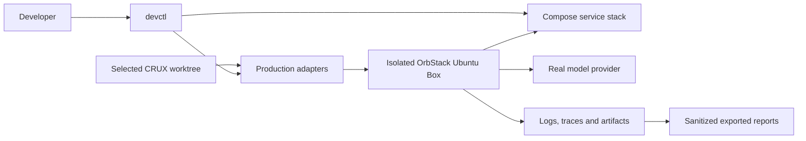

# Local environment design

The host Invoker selects one trusted CRUX worktree and copies tracked source and
caller inputs into an isolated Ubuntu Box. Production scripts install/configure
the selected Scaffold. The production systemd unit executes the Run as `ubuntu`;
there is no container runner. Service containers supply reusable infrastructure.

| Directory | Responsibility |
| --- | --- |
| `ciab_devenv/` | Host commands, selected source and private environment settings |
| `devops/` | Production source lookup and Box configuration adapters |
| `monitoring/` | Bounded execution and report collection |
| `services/` | Reusable protocol fixtures and service checks |
| `verification/` | Feature-independent execution/inspection helpers |
| `tests/` | Environment orchestration and fixture regression tests |

Source lookup follows canonical component directories, with older layouts supported
for earlier PRs. There is no source-layout manifest. Production owns Scaffold
behavior; the adapters supply local endpoints, certificates and OS integration.

Langfuse and storage are local services; Slack/mailbox/cloud APIs are limited
fixtures. They never forward messages or cloud mutations to vendors. Actual inference
uses the selected provider and dedicated test credentials. Explicit per-service
live overrides have no automatic fallback. OrbStack behavior cannot establish
real EC2, IAM, network, certificate-authority or GPU acceptance.

Source and inputs are root-owned on the Box. No host Docker socket, home directory,
SSH agent or cloud credentials are exposed to research code. Named environment
settings and evidence remain private; reports record source/model/service identity
and outcomes. Feature-specific assertions remain in the implementing CRUX PR.
The Box reaches fixtures through loopback ports published by Compose. The base
operator port derives the HTTPS port (`+1`) and storage port (`+2`); only that base
port is caller-configurable. Two systemd-managed TCP relays on the Box preserve
stable fixture hostnames and TLS end to end, including SDKs with fixed API ports.
This avoids depending on direct routing between an isolated machine and Docker
bridge addresses. Other containers keep their private Compose connections.

Deployment metadata lives at `/etc/ciab-deployment.json` on the isolated Box.
Execution reads it and compares its installed source/scaffold against the selected
worktree. A stopped Box reports installation status as unknown; status never wakes
it. Laptop reports are evidence only and are not required to operate the Box.
Production contracts are imported from the selected worktree under a unique
module name so testing two revisions cannot accidentally reuse another's code.

The production `Lifecycle` reconciles local services before the Box and deletes
in reverse order. Compose resources use stable `io.crux.owner` labels. OrbStack
has no resource tags, so `ciab-NAME-run` is a reserved namespace for isolated test
machines; `reset --confirm NAME` explicitly selects that machine for deletion.
Neither driver reads a laptop resource receipt. Stopped Boxes can be discovered
and deleted without starting their services. Do not manually reuse reserved
machine names for unrelated work.

Shutdown waits for OrbStack to report the named Box stopped before returning; a
bounded timeout surfaces stalled shutdown while preserving evidence for cleanup.

The bundle adapter imports the selected source's assembler on the host and runs
its Box staging implementation inside OrbStack. It then installs/configures the
same production Scaffold with explicit local fixture endpoints. Bundle hashes
and installed source identity are recorded in evidence and on the Box; temporary
payloads are not an operational database.

Graph inspection dispatches Run and independent controller declarations to the
selected production contract. It performs no cloud calls and does not create an
AgentRQ controller. The normal local AgentRQ service remains a reusable fixture.

Dependency installation consumes package-manager manifests directly. Dependabot
updates those same Python, Compose, Dockerfile and GitHub Actions declarations.
The scheduled service audit resolves images from Compose, exports SPDX and scans
vulnerabilities. Box package inventory complements these image reports with the
actual provisioned packages recorded by the environment.
