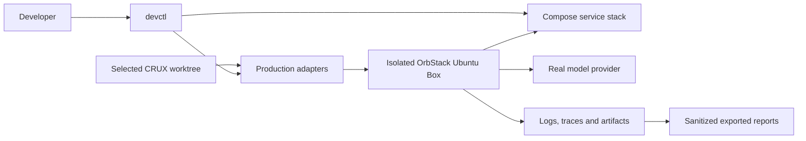

# Local environment design

The host Invoker selects one trusted CRUX worktree and copies tracked source and
caller inputs into an isolated Ubuntu Box. Production scripts install/configure
the selected Scaffold. The production systemd unit executes the Run as `ubuntu`;
there is no container runner. Service containers supply reusable infrastructure.

| Directory | Responsibility |
| --- | --- |
| `ciab_devenv/` | Host commands, selected source and private environment settings |
| `devops/` | Production source lookup and Box configuration adapters |
| `monitoring/` | Bounded execution and report collection |
| `services/` | Reusable protocol fixtures and service checks |
| `verification/` | Feature-independent execution/inspection helpers |
| `tests/` | Environment orchestration and fixture regression tests |

Source lookup follows canonical component directories, with older layouts supported
for earlier PRs. There is no source-layout manifest. Production owns Scaffold
behavior; the adapters supply local endpoints, certificates and OS integration.

Langfuse and storage are local services; Slack/mailbox/cloud APIs are limited
fixtures. They never forward messages or cloud mutations to vendors. Actual inference
uses the selected provider and dedicated test credentials. Explicit per-service
live overrides have no automatic fallback. OrbStack behavior cannot establish
real EC2, IAM, network, certificate-authority or GPU acceptance.

Source and inputs are root-owned on the Box. No host Docker socket, home directory,
SSH agent or cloud credentials are exposed to research code. Named environment
settings and evidence remain private; reports record source/model/service identity
and outcomes. Feature-specific assertions remain in the implementing CRUX PR.
